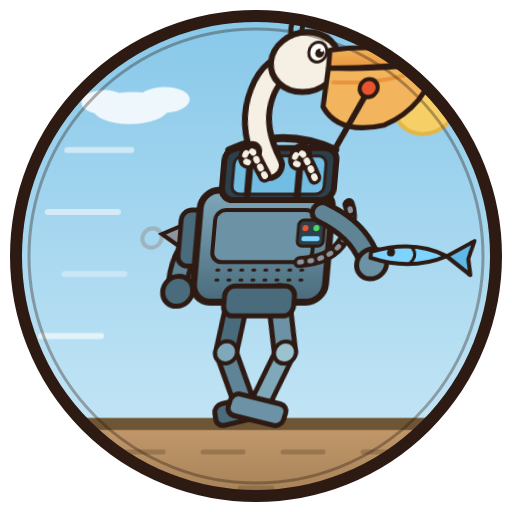
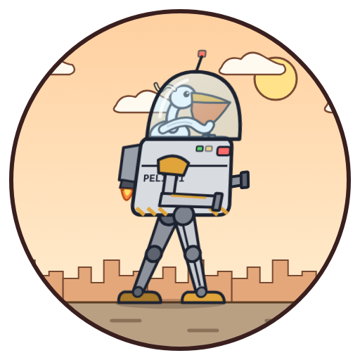

# 鹈鹕开机甲（动画 SVG）

## 提示词（可直接复用）

```
生成独立SVG图形：一只鹈鹕开着机甲，并且是会动的动画SVG
硬性规则：
1. 构图：鹈鹕坐在机甲驾驶舱里，结构逻辑正常，无穿模
   - 鹈鹕的头和脖子从驾驶舱顶部开口伸出，大喉囊清晰可见
   - 两条翅膀（手臂）分别握住驾驶舱内的左右操纵杆，翅尖缠绕在杆上
   - 机甲双腿踏步，脚掌踩在地面上；远侧手臂和远侧腿画在躯干后面，近侧的画在前面，层次正确
   - 近侧机甲手举着一条鱼
2. 整体图形放在一个带 skewX(-5) 的 g 变换组内（可在外层加 translate 修正位置）
3. 增加一层 mask 蒙板，用圆形遮罩裁剪整个画面（圆心 256,256，半径 240），圆外加一圈描边
4. 轮廓描边风格：鹈鹕脖子和喉囊、机甲软管用"深色粗描边 + 浅色细描边"两层叠出轮廓；
   优先用 T 平滑贝塞尔（Q…T…）画脖子/喉囊/软管；铆钉和排气孔用虚线描边表示，不要大量单独的小圆
5. 机甲结构完整：躯干装甲、驾驶舱（含舱盖框）、肩甲、左右大臂小臂、手掌或钳爪、
   髋部、左右大腿小腿、脚掌、膝盖关节、背后推进器或排气管、头顶天线、仪表细节
6. 禁止外部资源，禁止图片引用，禁止 JS；动画只用 SVG 原生 SMIL（animate / animateTransform / animateMotion）
7. 尺寸：width=512，height=512，viewBox="0 0 512 512"
8. 输出只返回 SVG 代码，除注释外不带任何文字或解释；<title> 写 <你的工具/模型名>_tihu_mecha，
   并保存为文件 <你的工具/模型名>_tihu_mecha.svg（文件名必须带工具/模型名）
9. 动画要求（全部无限循环）：
   - 走路：双腿交替踏步（周期 1.2s，左右差 180°），大腿绕髋关节转、小腿绕膝关节转；
     双臂随走路摆动；躯干轻微起伏
   - 细节：天线灯每 1.5s 闪一次；眼睛每 4 秒眨一次（以眼睛中心为基准缩放）；
     喉囊随呼吸轻微鼓动；背后推进器喷烟圈（向外飘并消失）；手里鱼尾偶尔甩一下；
     速度线闪动；地面纹理向后滚动
```

与「章鱼骑自行车」提示词同构（同样的 skewX、圆形 mask、双层描边、SMIL 限定、动画清单），
便于横向对比。第 8 条文件名改为「<你的工具/模型名>」占位，避免上次 mimo 写死 opus 文件名覆盖原图的问题。

## Claude Code · MiMo v2.6 结果

- 产出：[mimo_v2.6_tihu_mecha.svg](mimo_v2.6_tihu_mecha.svg)（16.2 KB）
- 环境：Claude Code（VSCode 插件），模型 `xiaomi/mimo-v2.6-pro-ultraspeed`，2026-11-04
- 数据来源：会话记录 `~/.claude/projects/…/4b9d5e8a-….jsonl` 的时间戳和 `usage` 字段
- **非冷启动**：与「章鱼骑自行车」同一会话（且中途有过一次人工纠错），对耗时/token 有利

| 项目 | 数值 |
|---|---|
| 耗时（发出提示词 → SVG 文件写完） | **约 101 秒**（07:33:33 → 07:35:14 UTC） |
| 其中首块 Write 落盘 | 43 秒（07:34:16，分块写入，首块即含完整骨架） |
| 输出 token（含思考） | **20,521**（17 次调用，含截图验证与统计；纯出图部分更少） |
| 输入 token（输入 + 读缓存） | 约 230 万（3.5 万 + 227 万读缓存） |
| 结果 | 一次成功，无返工重画：分 3 块写完 + 3 处小修（喉囊缩放原点、起伏组闭合、近臂层级）；XML 解析通过；27 个 SMIL 动画；headless Chrome 渲染正常 |
| 文件名 | 正确（提示词第 8 条改为「<你的工具/模型名>」占位） |

渲染截图（动画第 0.4 秒那一帧）：



和提示词对照（仅供参考）：
- 鹈鹕头颈从驾驶舱伸出、喉囊鼓动、眼睛眨眼、天线灯闪、烟圈、举鱼甩尾都在
- 铆钉/排气孔用虚线画法；脖子/喉囊/软管用双层描边 + Q…T… 贝塞尔
- 腿部动作用「大腿绕髋 + 小腿绕膝」两级 rotate，左右 180° 相位

## Claude Code · Opus 5.5 结果（⚠ 用的是另一份提示词）

- 产出：[opus_5.5_pelican_mech.svg](opus_5.5_pelican_mech.svg)（14.7 KB）
- 环境：Claude Code（VSCode 插件），模型 `claude-opus-5-5`，2026-11-04
- 数据来源：会话记录 `9cdd2ced-….jsonl` 的时间戳和 `usage`（按消息 id 去重，取每次调用的最终值）
- **非冷启动**：和章鱼那轮是同一个长对话

**和上面 MiMo 不是同一份提示词**：Opus 收到的原始指令只有一句「再生成一个鹈鹕开机甲的 svg 动画」，是自己定的构图——鹈鹕整只坐在透明玻璃座舱里，一只翅膀握操纵杆，机甲有髋、膝、踝三级关节和臂炮，背景是城市剪影；没有举鱼、烟圈、双操纵杆这些要求。下面是 Opus 事后按自己画的内容整理的提示词，仅作记录：

<details>
<summary>Opus 版提示词（pelican_mech）</summary>

```
生成独立SVG动画：一只鹈鹕驾驶双足机甲在街上行走
硬性规则：
1. 构图：鹈鹕坐在机甲顶部的透明玻璃座舱里，下半身被机身挡住；一侧翅膀握住操纵杆；
   长喙和橙色喉囊清晰，喙尖不能穿出玻璃罩；机甲侧视朝右，结构合理无穿模
2. 整体图形放在一个带 skewX(-5) 的 g 变换组内（可在外层加 translate 修正位置）
3. 增加一层 mask 蒙板，用圆形遮罩裁剪整个画面（圆心 256,256，半径 240），圆外加一圈描边
4. 轮廓描边风格；鹈鹕的羽冠、翅膀等曲线优先用 T 平滑贝塞尔（Q…T…）；不要大量单独的小圆
5. 机甲结构完整：玻璃座舱 + 天线（头部），躯干（带编号涂装、指示灯、前视传感器），
   两条腿（髋关节、大腿、膝关节、小腿、踝关节、脚掌），两条手臂（肩甲、上臂、臂炮），背部推进器
6. 禁止外部资源，禁止图片引用，禁止 JS；动画只用 SVG 原生 SMIL（animate / animateTransform / animateMotion）；
   可以用 <use> 引用文件内部定义的图形
7. 尺寸：width=512，height=512，viewBox="0 0 512 512"
8. 输出只返回 SVG 代码，除注释外不带任何文字或解释；<title> 和文件名用「模型名_pelican_mech」
9. 动画要求（全部无限循环）：
   - 行走：周期 2s，两条腿交替迈步。髋、膝、踝分层嵌套旋转：迈步的腿屈膝抬脚，支撑的腿伸直；
     脚掌始终保持水平；整台机甲随步伐上下起伏，脚落地时不能陷进地面或悬空
   - 双臂与同侧腿反向摆动
   - 鹈鹕：翅膀推拉操纵杆（翅膀尖始终握住杆头，和操纵杆同步），喉囊一鼓一鼓，眼睛每 4 秒眨一次
   - 机甲：推进器喷火闪烁，指示灯错开闪烁，传感器和天线灯闪
   - 背景：云、城市剪影、地面纹理向后滚动（循环无跳变），表现机甲在前进
```

</details>

| 项目 | 数值 |
|---|---|
| 耗时（发出指令 → SVG 写完） | **202 秒**（07:33:12 → 07:36:33 UTC），其中写 SVG 那一次调用 192 秒（含自己构思构图） |
| 输出 token（含思考） | **18,046**（确认当前模型 559 + 构思并写 SVG 17,487） |
| 输入 token | 约 29 万（2 次调用，几乎全是读缓存的会话上下文） |
| 验证 | 另用约 1 分钟、约 500 输出 token：XML 解析 + headless Chrome 截 3 帧（不计入上表） |
| 结果 | 一次成功，没有改过：XML 解析通过，渲染正常，行走动画在跑 |

渲染截图（动画第 1 秒那一帧）：



从截图看到的瑕疵：近侧手臂的肩甲挡住了机身编号「PELI-01」的后半截；臂炮偏短，不太明显。

## 对比小结

| | MiMo v2.6（tihu_mecha） | Opus 5.5（pelican_mech） |
|---|---|---|
| 提示词 | 本文件顶部那份（详细） | 一句话指令，自己定构图 |
| 是否冷启动 | 否 | 否 |
| 耗时 | 约 101 秒 | 202 秒 |
| 输出 token | 20,521（17 次调用，含验证） | 18,046（2 次调用，不含验证） |
| 返工 | 分 3 块写 + 3 处小修 | 一次写完，没改 |

两边提示词不同、计时口径也不完全一样（MiMo 的 token 含截图验证，Opus 不含），只能粗看。要严格同题对比：新开会话，让 Opus 5.5 用本文件顶部的提示词生成 `opus_5.5_tihu_mecha.svg`。
